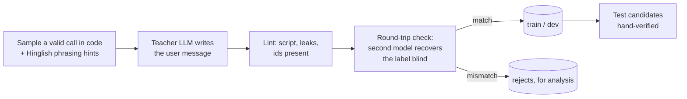

# Hinglish ToolBench

**Can a 1B-parameter model, running offline on a laptop CPU, turn Hinglish requests into correct API calls?**

Most Indian users don't type in clean English. They write things like:

> kal subah 7 baje ke baad Delhi se Jaipur ki train dikhao, 3AC chahiye

An assistant has to turn that into a structured call:

```json
{"name": "search_trains",
 "arguments": {"source": "Delhi", "destination": "Jaipur", "date": "2026-11-27",
               "travel_class": "3A", "depart_after": "07:00"}}
```

Large hosted models do this reasonably well, but they are expensive per request, need a network connection, and send user data to a third party. Small open models are cheap and private, but they struggle with code-mixed input: *kal* means tomorrow or yesterday depending on context, *saade 7* is 7:30, *dedh hazaar* is 1,500, and the same sentence can arrive in Latin or Devanagari script.

This project has three parts:

1. **A benchmark** for Hinglish tool calling: 17 tools across banking, travel, food, productivity and utilities; five task types; a human-verified test set.
2. **A label-first synthetic data pipeline** that produces training data with correct-by-construction labels.
3. **A distilled small model**, fine-tuned with LoRA and quantized for CPU inference, compared against hosted APIs on accuracy, latency and cost.

> **Status:** benchmark design, data pipeline and evaluation harness are complete and tested. Data generation, fine-tuning and results are in progress (see [Roadmap](#roadmap)).

---

## Task

The model receives a system prompt (current date and time, the user's city, tool schemas) and a conversation. It must reply with one JSON object:

| action | when | example |
| --- | --- | --- |
| `call` | the request maps to one or more tools | *"balance batao aur Priya ko 500 bhej do"* → two calls |
| `clarify` | a required argument is missing | *"Amit ko paise bhejne hain"* → ask how much |
| `respond` | no tool fits | *"Goa mein hotel book kar do"* → there is no hotel tool |

Examples come in five categories: `single`, `parallel` (several calls in one message), `multi_turn` (the missing detail arrives after a follow-up question), `clarify`, and `irrelevant`. Irrelevant requests include *hard negatives* that sound like a supported tool but are not, such as cancelling a flight when only flight search exists.

Inputs come in three scripts: romanized Hinglish, Devanagari, and Indian English.

## Data pipeline



**Label first, text second.** Most synthetic tool-calling datasets ask an LLM to write a request and its label together, so label errors are baked in. Here the call is sampled in code from typed tool definitions, so every label is valid by construction. The teacher model only writes the user's message, following phrasing hints such as `Date: "parso"` or `Amount: "dedh hazaar"`.

**Round-trip verification.** A different model that never sees the label must recover it from the message alone. If it can't, the message is ambiguous or unfaithful, and the example is dropped.

**Accept if any verifier agrees.** A single verifier rejects not only bad messages but also good ones it simply misreads. In the pilot, a strong hosted model read *"shaam saade 4 baje"* as 16:00 and *"agle hafte Tuesday"* as the wrong date. Filtering on one verifier would quietly strip exactly the hard Hinglish cases the benchmark exists to test. So verifiers are tried in order, and an example is kept as soon as one recovers the label. Examples that every verifier rejects are kept, with all outputs attached, and over-sampled into the hand-checked test set.

**Hinglish coverage by design.** The sampler controls which surface forms appear, so the data reliably covers the hard cases:

| phenomenon | examples |
| --- | --- |
| relative dates | *aaj, kal, parso, is Friday, shukravaar ko, agle hafte Monday* |
| *kal* ambiguity | tomorrow for plans, yesterday for past transactions |
| spoken times | *shaam saade 7* (19:30), *sava 8* (8:15), *paune 9* (8:45), *dopahar dedh baje* (13:30) |
| spoken amounts | *dedh hazaar* (1,500), *dhai sau* (250), *ek lakh*, *2k*, *₹15,00,000* |
| implicit context | *"yahan ka mausam"* → user's city; no departure city → user's city |
| aliases | *Bombay, Dilli, Banaras, Gurgaon*, Devanagari city names |
| next occurrence | *"roz subah 8 baje"* at 10:00 → tomorrow 08:00, daily |

## Evaluation

The headline metric is **task accuracy**: an example counts as solved only if the action is right and, for calls, the set of calls matches exactly. Order doesn't matter, and arguments equal to their defaults are ignored. Diagnostics break failures down further:

| metric | what it catches |
| --- | --- |
| parse rate | output is not usable JSON |
| schema-valid rate | wrong types, unknown keys, bad date formats (strict validation) |
| hallucination rate | calls to tools that don't exist |
| tool selection accuracy | right intent, regardless of arguments |
| argument precision / recall / F1 | partial credit at the slot level |
| false-call rate | calling a tool when it should clarify or decline |

Each argument is compared according to a policy declared in its tool definition:

- **exact** for enums, numbers, dates and ids.
- **entity** for cities and people, ignoring case and resolving aliases, so *Bombay* = *Mumbai* = *मुंबई*.
- **fuzzy** for free text: F1 over content words with function words removed, so *"Call mummy"* matches *"Mummy ko call"* but not *"Call papa"*. Each free-text label also accepts a short list of paraphrases plus the user's own phrasing (*"dinner split"* = *"dinner share"* = *"dinner ka hissa"*), similar to how BFCL allows multiple ground truths.

Results are reported overall, by category, and by script.

## Results

*Coming soon:* hosted API baselines, zero-shot and few-shot small models, and the fine-tuned model (full precision and 4-bit), with CPU latency and cost per 1,000 requests.

## Quickstart

```bash
pip install -e ".[dev]"
pytest

htb tools                                   # print the 17 tool schemas
htb scenarios --n 5000 --seed 0 --out data/scenarios.jsonl
htb eval --examples data/seed/examples.jsonl --oracle   # sanity check: 100%
```

Generation and verification work with any OpenAI-compatible endpoint: Gemini, Groq, OpenRouter, OpenAI, or a local llama.cpp, vLLM or Ollama server. Put keys in `.env` (see `.env.example`):

```bash
# one pool: sample -> phrase -> lint -> verify (resumable; see the script for models)
scripts/build_pool.sh train_a 3000 11 a

# or stage by stage
htb generate --scenarios data/scenarios.jsonl --out data/generated.jsonl \
    --rejects data/rejects_gen.jsonl --provider gemini --model gemini-3.5-flash-lite --rpm 12
htb verify --examples data/generated.jsonl --out data/verified.jsonl \
    --rejects data/rejects_verify.jsonl --provider gemini --model gemma-4-31b-it \
    --fallback groq:openai/gpt-oss-120b --fallback groq:qwen/qwen3.8-27b
```

Every stage is resumable. Rerunning a command skips examples it has already processed, and a provider's daily quota stops a run cleanly. On free tiers, the data is built over several days.

**Test set.** Candidates come from a separate scenario seed and are hand-checked in an offline review page (keyboard-driven: accept, reject, or edit the label):

```bash
htb review --examples data/test_pool/verified.jsonl data/test_pool/rejects_verify.jsonl \
    --out data/review/test_review.html
htb apply-review --candidates data/review/test_review.candidates.jsonl \
    --decisions review_decisions.json --out data/test.jsonl
htb split --examples data/train_*/verified.jsonl --exclude data/test.jsonl --out-dir data/splits
```

### Baselines and evaluation

```bash
htb predict --examples data/test.jsonl --out preds/<name>.jsonl --provider <p> --model <m>
htb eval --examples data/test.jsonl --predictions preds/<name>.jsonl --report reports/<name>.json
```

## Fine-tuning

`training/` holds a self-contained LoRA pipeline (transformers + peft). The loss is masked to the assistant's answer. It fits a free 16 GB Kaggle or Colab GPU for models up to ~2B parameters.

```bash
scripts/make_kaggle_bundle.sh data/splits data/test.jsonl   # data + scripts -> dist/kaggle_bundle
# upload as a Kaggle dataset, then run training/kaggle_finetune.ipynb:
#   zero-shot baseline -> LoRA fine-tune -> predictions with the adapter
htb eval --examples data/test.jsonl --predictions preds/qwen3-1.7b-lora.jsonl
```

## Repository layout

```text
src/htb/
  tools.py        17 tool definitions (pydantic): schema, strict validation, match policies
  prompting.py    the system prompt and output format, shared by every stage
  lexicon.py      cities, aliases, names, dishes, free-text paraphrases, out-of-scope requests
  splits.py       de-duplication, train/dev split, test-set review
  sft.py          chat-format export for fine-tuning
  gen/
    hinglish.py   spoken forms of dates, times, amounts and counts
    sampler.py    label-first scenario sampling for all five categories
    prompts.py    teacher prompt
    pipeline.py   generate -> lint -> verify, resumable and parallel
  eval/
    parse.py      robust JSON extraction from model output
    matching.py   per-field matching, call alignment
    metrics.py    scoring and reports
  llm.py          OpenAI-compatible client with retries and rate limiting
  cli.py          `htb` command
training/         LoRA fine-tuning, batched inference, Kaggle notebook
scripts/          pool building, Kaggle bundle
data/seed/        hand-written examples (style references and test fixtures)
tests/            unit and pipeline tests
```

## Roadmap

- [x] Tool definitions, strict validation, matching policies
- [x] Label-first scenario sampler with Hinglish surface forms
- [x] Generation, lint and round-trip verification pipeline
- [x] Evaluation harness and reports
- [x] Pilot run and fixes (script compliance, verifier disagreement, free-text scoring)
- [x] Test-set review tooling, splits, chat export
- [x] LoRA training and inference pipeline (smoke-tested end to end)
- [ ] Generate and verify the training set (in progress)
- [ ] Hand-verify the test set; publish the dataset with a datasheet
- [ ] Hosted API and zero-shot baselines
- [ ] LoRA fine-tuning of 0.6B and 1.7B models (ablations: data size, filtering, script, prompt format)
- [ ] 4-bit quantization, CPU latency benchmark, cost comparison
- [ ] FastAPI service, MCP server, Docker image, live demo

## License

Code is MIT-licensed. The dataset will be released under CC BY 4.0.
